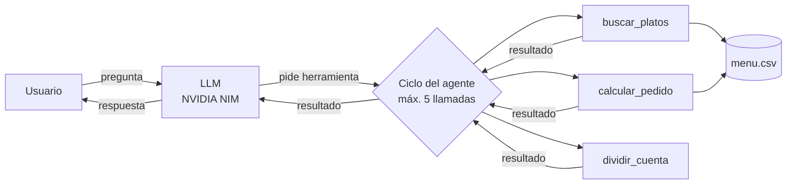

# ☕ Antojo — Asistente inteligente para la cafetería universitaria

**Proyecto final · SI3003 Inteligencia Artificial · Universidad EAFIT · 2026-2**

| Integrantes |
|---|
| David Ríos |
| Juan Pablo Gaviria |
| Sara Echeverri |

**Opción elegida:** B — Agente con herramientas

---

## 1. Problema

Entre clase y clase hay poco tiempo, y en la cafetería se repiten las mismas preguntas: qué hay vegetariano o sin lactosa, qué almuerzo alcanza con cierto presupuesto, cuánto cuesta un pedido y cuánto paga cada uno cuando se divide la cuenta.

Responder bien exige consultar datos estructurados y hacer cálculos exactos. Un modelo de lenguaje por sí solo puede inventar un precio o sumar mal, así que Antojo delega esas tareas en funciones de Python: el modelo entiende la pregunta, decide qué herramienta usar y comunica el resultado.

**Usuarios:** estudiantes, profesores y personal que compra en la cafetería.

**Fuera del alcance:** pedidos o pagos reales, inventario en tiempo real, varias cafeterías e información nutricional detallada.

## 2. ¿Por qué un agente y no RAG?

El problema es de **datos tabulares y cálculos**. Filtrar por precio o restricción es una condición exacta, no una búsqueda por similitud de texto, y una suma debe salir de código, no del modelo. Un agente con herramientas resuelve ambas cosas; un RAG no.

## 3. Arquitectura



| Herramienta | Argumentos | Qué devuelve |
|---|---|---|
| `buscar_platos` | `categoria`, `restriccion`, `precio_max` (opcionales) | Productos que cumplen los filtros, del más barato al más caro |
| `calcular_pedido` | `items`, `cantidades` | Detalle y total; lista en `no_encontrados` lo que no está en el menú |
| `dividir_cuenta` | `total`, `personas` | Valor por persona (redondeado hacia arriba al peso) |

**Límite de llamadas:** máximo 5 herramientas por pregunta. Antes de ejecutar cada herramienta se revisa el contador; si ya se hicieron 5, el agente se detiene y responde *"No pude completar tu solicitud con las consultas disponibles. ¿Puedes reformularla o hacerla más específica?"*. Esto evita ciclos infinitos y consumo innecesario de créditos.

**Otras decisiones:**
- Si una herramienta falla (argumento faltante, tipo incorrecto), el error se le devuelve al modelo como texto en vez de detener el programa, para que pueda corregir la llamada.
- `temperature=0` para que las pruebas sean lo más reproducibles posible.
- Búsqueda de productos tolerante a mayúsculas, tildes y plurales simples ("empanadas" → "Empanada").

## 4. Estructura

```
├── README.md
├── requirements.txt
├── data/
│   └── menu.csv              # menú ficticio (30 productos)
├── src/
│   ├── herramientas.py       # funciones + esquemas que ve el modelo
│   └── agente.py             # ciclo del agente, prompt de sistema, límite
└── notebooks/
    └── antojo.ipynb          # demo, 5 casos de prueba y chat
```

## 5. Cómo ejecutarlo

**Clave de API:** crear una cuenta en [build.nvidia.com](https://build.nvidia.com) y generar una clave (empieza con `nvapi-`). **La clave nunca va en el código ni en el repositorio.**

**En Google Colab (recomendado)**
1. Abrir `notebooks/antojo.ipynb` en Colab.
2. En el ícono 🔑 de la barra lateral, crear el secreto `NVIDIA_API_KEY` con la clave y activar el acceso del notebook.
3. En la celda de preparación, poner la URL de este repositorio en `REPO_URL`.
4. *Entorno de ejecución → Ejecutar todas.*

**Localmente**
```bash
pip install -r requirements.txt
export NVIDIA_API_KEY="nvapi-..."      # en Windows: set NVIDIA_API_KEY=nvapi-...
jupyter notebook notebooks/antojo.ipynb
```

El modelo por defecto es `mistralai/mistral-large-4-1t-a52b`. Se puede cambiar con la variable de entorno `ANTOJO_MODEL`.

**Fuentes y herramientas:** menú ficticio creado por el equipo; Python, pandas, cliente `openai` contra el endpoint compatible de NVIDIA NIM; ciclo adaptado de `part01_from_prompt_to_action.ipynb` (Lecture 11).

## 6. Casos de prueba

Resultados obtenidos al ejecutar el notebook en Colab (también en `resultados_pruebas.json`). **Resultado: 5 de 5 casos correctos.**

| # | Tipo | Pregunta | Resultado esperado | Herramientas esperadas | Respuesta obtenida | Valoración |
|---|---|---|---|---|---|---|
| 1 | Habitual | ¿Qué almuerzos vegetarianos hay por menos de 15.000? | Sopa de lentejas con arroz ($12.500) y Bandeja vegetariana ($14.500) | `buscar_platos` | ¡Hola! Estos son los almuerzos vegetarianos por menos de $15.000: 1. Sopa de lentejas con arroz — $12.500 (También es sin lactosa) 2. Bandeja vegetariana — $14.500 ¿Te gustaría saber algo más sobre alguno de ellos? (`buscar_platos`) | ✅ Correcta. 1 llamada (`buscar_platos`) con los tres filtros bien puestos. |
| 2 | Habitual | ¿Cuánto me cuestan dos empanadas y un jugo? | $10.500 | `calcular_pedido` | ¡Hola! Dos empanadas ($3.000 c/u) y un jugo natural ($4.500) te cuestan en total: $10.500 (`buscar_platos` → `buscar_platos` → `calcular_pedido`) | ✅ Correcta ($10.500). Hizo 2 `buscar_platos` extra (snack y bebida) para confirmar nombres antes de `calcular_pedido`; 3 llamadas en vez de 1. |
| 3 | Habitual | Pedimos una bandeja paisa y tres tintos, somos dos, ¿cuánto paga cada uno? | Total $24.000; $12.000 cada uno | `calcular_pedido` → `dividir_cuenta` | ¡Listo! - Bandeja paisa: $19.500 - 3 tintos: $4.500 (3 × $1.500) - Total: $24.000 Como son dos personas, cada uno paga $12.000. (`calcular_pedido` → `dividir_cuenta`) | ✅ Correcta ($24.000; $12.000 c/u). Secuencia exacta `calcular_pedido` → `dividir_cuenta`. |
| 4 | Combina herramientas | Quiero el almuerzo sin lactosa más barato y un jugo, ¿cuánto pago? | Sopa de lentejas con arroz + Jugo natural = $17.000 | `buscar_platos` → `calcular_pedido` | ¡Hola! El almuerzo sin lactosa más barato es la Sopa de lentejas con arroz a $12.500. Agregando un Jugo natural ($4.500), tu total sería: $17.000 ¿Te gustaría ordenar algo más? (`buscar_platos` → `buscar_platos` → `calcular_pedido`) | ✅ Correcta ($17.000). Eligió bien el almuerzo sin lactosa más barato; hizo un `buscar_platos` extra (bebidas) para confirmar el jugo. |
| 5 | Caso límite | ¿Cuánto cuestan dos sushis? | Dice que no está en el menú, sin inventar precio | `calcular_pedido` (devuelve `no_encontrados`) | Lo siento, en nuestra cafetería no tenemos sushi en el menú, así que no puedo darte un precio. Si te interesa algo para el almuerzo, tenemos opciones como el Wrap de pollo ($15.000), la Ensalada mediterránea ($15.500) o el Arroz con pollo ($16.000). ¿Te gustaría saber algo más? (`calcular_pedido` → `buscar_platos` → `buscar_platos`) | ✅ Correcta. Dice que no hay sushi y no inventa precio. Además sugirió alternativas con precios reales del menú (2 `buscar_platos` extra). |

**Trazas de herramientas** (salida del notebook, casos 3 y 4):

*Caso 3*
```
👤 Pedimos una bandeja paisa y tres tintos, somos dos, ¿cuánto paga cada uno?
🔧 calcular_pedido({"items": ["Bandeja paisa", "Tinto"], "cantidades": [1, 3]})
   → {"detalle": [{"producto": "Bandeja paisa", "cantidad": 1, "precio_unitario": 19500, "subtotal": 19500}, {"producto": "Tinto", "cantidad": 3, "precio_unitario": 1500, "subtotal": 4500}], "total": 24000}
🔧 dividir_cuenta({"total": 24000, "personas": 2})
   → {"total": 24000.0, "personas": 2, "por_persona": 12000}
🤖 ¡Listo! 🍽️

- **Bandeja paisa:** $19.500
- **3 tintos:** $4.500 (3 × $1.500)
- **Total:** $24.000

Como son **dos personas**, cada uno paga **$12.000**. ☕
```

*Caso 4*
```
👤 Quiero el almuerzo sin lactosa más barato y un jugo, ¿cuánto pago?
🔧 buscar_platos({"categoria": "almuerzo", "restriccion": "sin_lactosa"})
   → {"cantidad": 4, "platos": [{"nombre": "Sopa de lentejas con arroz", "categoria": "almuerzo", "precio": 12500, "vegetariano": "si", "sin_lactosa": "si"}, {"nombre": "Arroz con pollo", "categoria": "almuerzo", "precio": 16000, "vegetariano": "no", "sin_lactosa": "si"}, {"nombre": "Pechuga a la plancha...
🔧 buscar_platos({"categoria": "bebida"})
   → {"cantidad": 7, "platos": [{"nombre": "Tinto", "categoria": "bebida", "precio": 1500, "vegetariano": "si", "sin_lactosa": "si"}, {"nombre": "Agua", "categoria": "bebida", "precio": 2500, "vegetariano": "si", "sin_lactosa": "si"}, {"nombre": "Café con leche", "categoria": "bebida", "precio": 3000, "v...
🔧 calcular_pedido({"items": ["Sopa de lentejas con arroz", "Jugo natural"], "cantidades": [1, 1]})
   → {"detalle": [{"producto": "Sopa de lentejas con arroz", "cantidad": 1, "precio_unitario": 12500, "subtotal": 12500}, {"producto": "Jugo natural", "cantidad": 1, "precio_unitario": 4500, "subtotal": 4500}], "total": 17000}
🤖 ¡Hola! 😊

El almuerzo **sin lactosa más barato** es la **Sopa de lentejas con arroz** a $12.500.

Agregando un **Jugo natural** ($4.500), tu total sería:

**$17.000** 💰

¿Te gustaría ordenar algo más?
```

## 7. Análisis de resultados

**Lo observado en las pruebas:** los 5 casos dieron la respuesta esperada y todos los precios y totales salieron de las herramientas, nunca del modelo. La diferencia principal con lo esperado es que el modelo hace llamadas de más: en los casos 2, 4 y 5 usó `buscar_platos` para confirmar nombres o sugerir alternativas antes o después de `calcular_pedido`. No afecta la respuesta, pero gasta más créditos y llega a 3 de las 5 llamadas permitidas; con pedidos más grandes podría acercarse al límite.

**Cambio de modelo:** el modelo original (`meta/llama-3.3-70b-instruct`) fue retirado de NVIDIA NIM el 26/08/2026 (error 410), así que se usó `mistralai/mistral-large-4-1t-a52b`.

**Limitación verificada: nombres que no coinciden con el menú.** La búsqueda tolera tildes, mayúsculas y plurales, pero no diminutivos ni sinónimos: `calcular_pedido(["empanadita"], [1])` devuelve el producto en `no_encontrados`. Depende del modelo traducir "empanadita" a "Empanada" antes de llamar la herramienta; si no lo hace, el usuario recibe un "no está en el menú" aunque sí exista. Se prueba en la sección 6 del notebook (ver abajo).
*Mejora posible:* búsqueda aproximada (por ejemplo con `difflib.get_close_matches`) que devuelva sugerencias como "¿Quisiste decir Empanada?".

**Pruebas adicionales (sección 6 del notebook):**
- *Pregunta ambigua* ("Dame algo barato"): el modelo explicó su criterio ("por debajo de $10.000"), llamó `buscar_platos(precio_max=10000)` y listó las opciones por categoría. Cumple la regla del prompt de sistema.
- *Nombre que no coincide* ("¿Cuánto vale una empanadita?"): el modelo primero consultó el menú completo con `buscar_platos`, tradujo "empanadita" a "Empanada" y luego llamó `calcular_pedido` → $3.000. Funcionó, pero depende del modelo; la herramienta sola no lo resolvería.
- *Límite de llamadas* (forzado a 1): tras la primera llamada (`calcular_pedido`), el agente se detuvo antes de `dividir_cuenta` y respondió el mensaje de límite. `limite_alcanzado = True`, como se esperaba.

**Riesgos que siguen abiertos:** que con otro modelo se calcule por su cuenta sin llamar `calcular_pedido`, o que lleguen argumentos mal formados (el ciclo devuelve el error al modelo para que lo corrija).
