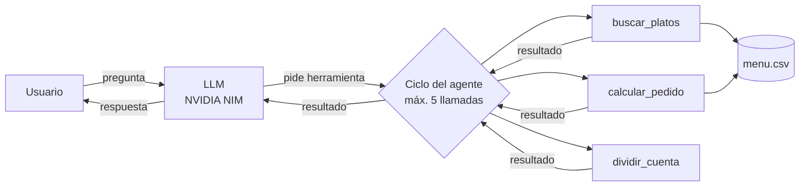

# ☕ Antojo — Asistente inteligente para la cafetería universitaria

**Proyecto final · SI3003 Inteligencia Artificial · Universidad EAFIT · 2026-2**

| Integrantes |
|---|
| David Ríos |
| Juan Pablo Gaviria |
| Sara Echeverry |

**Opción elegida:** B — Agente con herramientas

---

## 1. Problema

Entre clase y clase hay poco tiempo, y en la cafetería se repiten las mismas preguntas: qué hay vegetariano o sin lactosa, qué almuerzo alcanza con cierto presupuesto, cuánto cuesta un pedido y cuánto paga cada uno cuando se divide la cuenta.

Responder bien exige consultar datos estructurados y hacer cálculos exactos. Un modelo de lenguaje por sí solo puede inventar un precio o sumar mal, así que Antojo delega esas tareas en funciones de Python: el modelo entiende la pregunta, decide qué herramienta usar y comunica el resultado.

**Usuarios:** estudiantes, profesores y personal que compra en la cafetería.

**Fuera del alcance:** pedidos o pagos reales, inventario en tiempo real, varias cafeterías e información nutricional detallada.

## 2. ¿Por qué un agente y no RAG?

El problema es de **datos tabulares y cálculos**. Filtrar por precio o restricción es una condición exacta, no una búsqueda por similitud de texto, y una suma debe salir de código, no del modelo. Un agente con herramientas resuelve ambas cosas; un RAG no.

## 3. Arquitectura



| Herramienta | Argumentos | Qué devuelve |
|---|---|---|
| `buscar_platos` | `categoria`, `restriccion`, `precio_max` (opcionales) | Productos que cumplen los filtros, del más barato al más caro |
| `calcular_pedido` | `items`, `cantidades` | Detalle y total; lista en `no_encontrados` lo que no está en el menú |
| `dividir_cuenta` | `total`, `personas` | Valor por persona (redondeado hacia arriba al peso) |

**Límite de llamadas:** máximo 5 herramientas por pregunta. Antes de ejecutar cada herramienta se revisa el contador; si ya se hicieron 5, el agente se detiene y responde *"No pude completar tu solicitud con las consultas disponibles. ¿Puedes reformularla o hacerla más específica?"*. Esto evita ciclos infinitos y consumo innecesario de créditos.

**Otras decisiones:**
- Si una herramienta falla (argumento faltante, tipo incorrecto), el error se le devuelve al modelo como texto en vez de detener el programa, para que pueda corregir la llamada.
- `temperature=0` para que las pruebas sean lo más reproducibles posible.
- Búsqueda de productos tolerante a mayúsculas, tildes y plurales simples ("empanadas" → "Empanada").

## 4. Estructura

```
├── README.md
├── requirements.txt
├── data/
│   └── menu.csv              # menú ficticio (30 productos)
├── src/
│   ├── herramientas.py       # funciones + esquemas que ve el modelo
│   └── agente.py             # ciclo del agente, prompt de sistema, límite
└── notebooks/
    └── antojo.ipynb          # demo, 5 casos de prueba y chat
```

## 5. Cómo ejecutarlo

**Clave de API:** crear una cuenta en [build.nvidia.com](https://build.nvidia.com) y generar una clave (empieza con `nvapi-`). **La clave nunca va en el código ni en el repositorio.**

**En Google Colab (recomendado)**
1. Abrir `notebooks/antojo.ipynb` en Colab.
2. En el ícono 🔑 de la barra lateral, crear el secreto `NVIDIA_API_KEY` con la clave y activar el acceso del notebook.
3. En la celda de preparación, poner la URL de este repositorio en `REPO_URL`.
4. *Entorno de ejecución → Ejecutar todas.*

**Localmente**
```bash
pip install -r requirements.txt
export NVIDIA_API_KEY="nvapi-..."      # en Windows: set NVIDIA_API_KEY=nvapi-...
jupyter notebook notebooks/antojo.ipynb
```

El modelo por defecto es `meta/llama-3.3-70b-instruct`. Se puede cambiar con la variable de entorno `ANTOJO_MODEL`.

**Fuentes y herramientas:** menú ficticio creado por el equipo; Python, pandas, cliente `openai` contra el endpoint compatible de NVIDIA NIM; ciclo adaptado de `part01_from_prompt_to_action.ipynb` (Lecture 11).

## 6. Casos de prueba

> ✏️ **Completar** las columnas *Respuesta obtenida* y *Valoración* después de ejecutar el notebook (sección 7 genera la tabla y `resultados_pruebas.json`).

| # | Tipo | Pregunta | Resultado esperado | Herramientas esperadas | Respuesta obtenida | Valoración |
|---|---|---|---|---|---|---|
| 1 | Habitual | ¿Qué almuerzos vegetarianos hay por menos de 15.000? | Sopa de lentejas con arroz ($12.500) y Bandeja vegetariana ($14.500) | `buscar_platos` | | |
| 2 | Habitual | ¿Cuánto me cuestan dos empanadas y un jugo? | $10.500 | `calcular_pedido` | | |
| 3 | Habitual | Pedimos una bandeja paisa y tres tintos, somos dos, ¿cuánto paga cada uno? | Total $24.000; $12.000 cada uno | `calcular_pedido` → `dividir_cuenta` | | |
| 4 | Combina herramientas | Quiero el almuerzo sin lactosa más barato y un jugo, ¿cuánto pago? | Sopa de lentejas con arroz + Jugo natural = $17.000 | `buscar_platos` → `calcular_pedido` | | |
| 5 | Caso límite | ¿Cuánto cuestan dos sushis? | Dice que no está en el menú, sin inventar precio | `calcular_pedido` (devuelve `no_encontrados`) | | |

**Trazas de herramientas** (requisito: al menos dos). Pegar aquí la salida del notebook de los casos 3 y 4, por ejemplo:

```
👤 Pedimos una bandeja paisa y tres tintos, somos dos, ¿cuánto paga cada uno?
🔧 calcular_pedido({"items": ["Bandeja paisa", "Tinto"], "cantidades": [1, 3]})
   → {"detalle": [...], "total": 24000}
🔧 dividir_cuenta({"total": 24000, "personas": 2})
   → {"total": 24000.0, "personas": 2, "por_persona": 12000}
🤖 ...
```

## 7. Análisis de resultados

> ✏️ Ajustar con lo que realmente observen al ejecutar.

**Limitación verificada: nombres que no coinciden con el menú.** La búsqueda tolera tildes, mayúsculas y plurales, pero no diminutivos ni sinónimos: `calcular_pedido(["empanadita"], [1])` devuelve el producto en `no_encontrados`. Depende del modelo traducir "empanadita" a "Empanada" antes de llamar la herramienta; si no lo hace, el usuario recibe un "no está en el menú" aunque sí exista. Se prueba en la sección 6 del notebook.
*Mejora posible:* búsqueda aproximada (por ejemplo con `difflib.get_close_matches`) que devuelva sugerencias como "¿Quisiste decir Empanada?".

**Otros riesgos a revisar en las trazas:**
- Que el modelo calcule por su cuenta sin llamar a `calcular_pedido`, a pesar de la instrucción del prompt de sistema.
- Preguntas ambiguas ("dame algo barato"): el modelo debería explicar su criterio o pedir aclaración.
- Con modelos más pequeños, llamadas con argumentos mal formados; el ciclo devuelve el error al modelo para que lo corrija.
